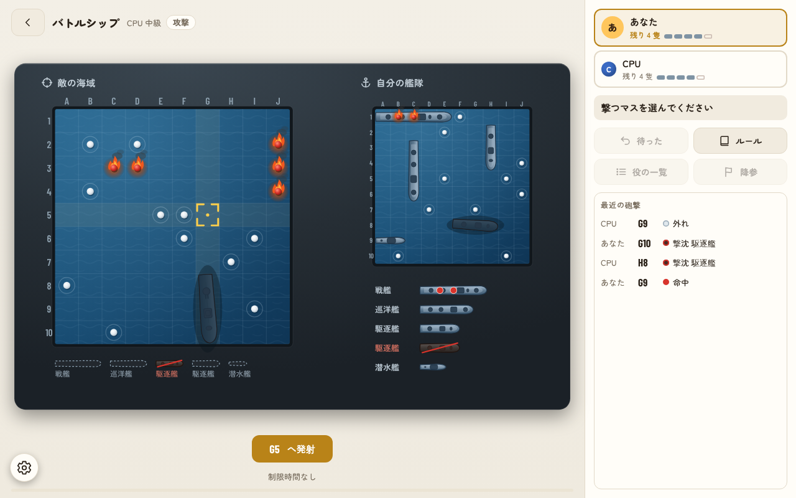
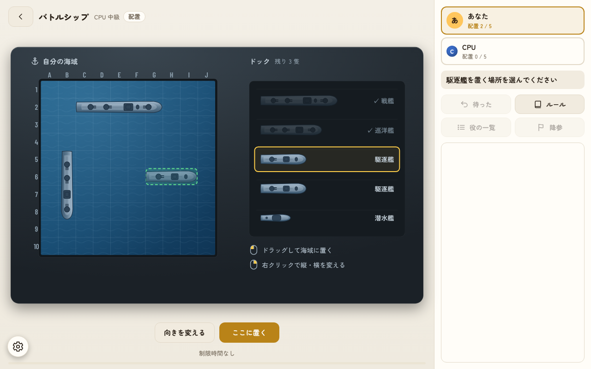
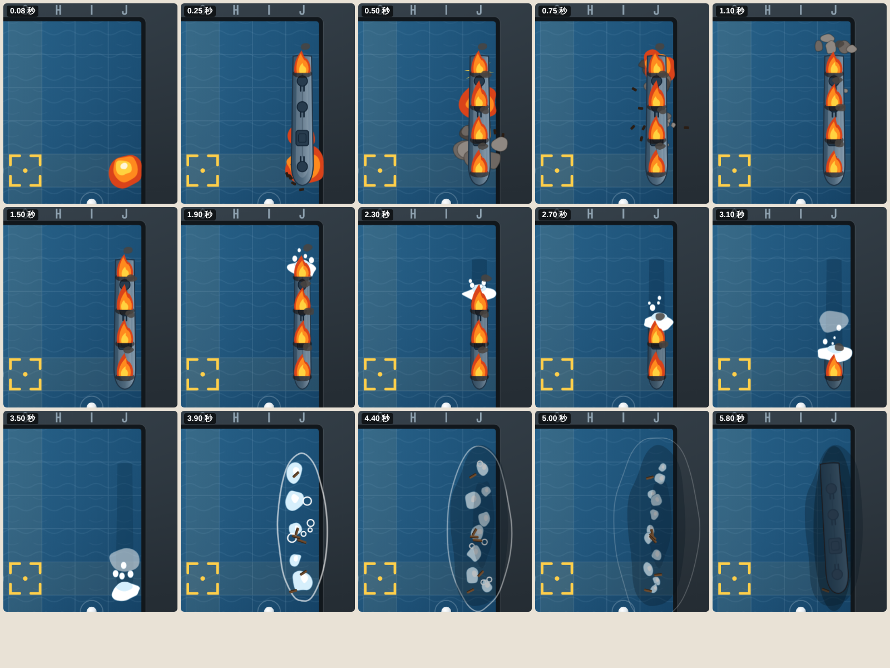

# バトルシップ — 盤面の見本(第 2 版・PC 版)

ユーザーの指摘(2026-11-28): AI が作った感じが強い(特に字)・爆発の質感・右側が文字だけで分かりにくい・側板の「撃沈 0/5」が数字でずれる・沈む演出と水柱。
並び(左に敵の海域、右に自分の艦隊、下に艦隊の一覧)と艦の絵はそのまま。撮影: `node docs/mockups/battleship-v2/shoot.cjs <woff2 のフォルダ>`(先に `python3 -m http.server -d web 8400`)。

| 攻撃中 | 配置 |
|---|---|
|  |  |

演出(2026-11-28 第 3 版: 「AI 感をなくす」ため、手描きエフェクトの定石に合わせて作り直し)。撮影: `node docs/mockups/battleship-v2/shoot_fx.cjs <woff2 のフォルダ>`(時間を止めたコマと動画)。

参考にした考え方(Web で調べた手描きエフェクトの資料から):
- 水は、見本の形を単純な図形に置き換えて描く。柔らかいぼかしの玉は使わない([Elemental Magic の要約](https://animateducated.blogspot.com/2013/10/efx-animation-water-splash.html)、[CLIP STUDIO の水の描き方](https://www.clipstudio.net/oekaki/archives/152851))。
- 水しぶきは「上と外へ」。重さで外へ折れ返り、粒は本体と同じ勢いで飛び、落ちた所に小さなしぶき([水しぶきのコマ解説](https://flashfx.blogspot.com/2014/01/water-splash-tutorial-part-2.html)、[School of Motion](https://www.schoolofmotion.com/blog/photoshop-animation-splash))。
- 段階に分けてコマを描く(上がる → 頂上 → 粒になる → 落ち着く)。少ないコマでもよい。
- 着水した所には平らな泡がしばらく残る([Unity の泡の説明](https://docs.unity3d.com/Packages/com.unity.render-pipelines.high-definition@17.0/manual/introduction-to-foam.html))。

やったこと:
- 色は平らな 3 色(白・水色・影の青)+細いふち。炎も平らな 4 色、煙は灰色のでこぼこの形。
- 動きはすべて 1 秒 12 コマのコマ送り(なめらかに伸び縮みさせない)。
- 消える時は薄くせず、小さなかけらに割れて小さくなって消える。

水柱(外れ・約 1 秒・`water.mp4`): 

- 着水のくぼみ → ひとかたまりの白い水が、根元は細く上へ広がりながら伸びる(てっぺんはもこもこのこぶ、中に水色の影と上と外へのすじ。上へ行くほど遅い)→ てっぺんがちぎれて丸いかたまりが外へ → 両肩が外へ垂れ、重さで低く広がって崩れる → 平らな泡 → 割れて小さくなり、波紋が外へ → 白いピン。(細い舌を並べた形は「もやしみたい」との指摘で、ひとかたまりの形に変えた)

撃沈(約 5.5 秒・`sink.mp4`): 

- 最後の 1 発が爆発し、2 コマずつずれて誘爆(火の玉 → 黒い煙のかたまり → 灰色に薄れて割れる。破片が飛ぶ)→ 隠れていた船体が現れて燃える(火は 3 コマの繰り返し)→ 傾いて幅が細く見え、艦尾から沈む(沈む境目に白い泡の帯がまとわりつき、帯の後ろは水の下の暗い影。艦首は少し持ち上がる)→ 沈んだ所で火は白い湯気になって消える → 泡のかけらが割れて小さくなり、木片が漂い、薄い油が残る → 盤の「沈んだ艦」の姿。
- 盤に残る命中の火も、演出と同じ平らな火にした。
