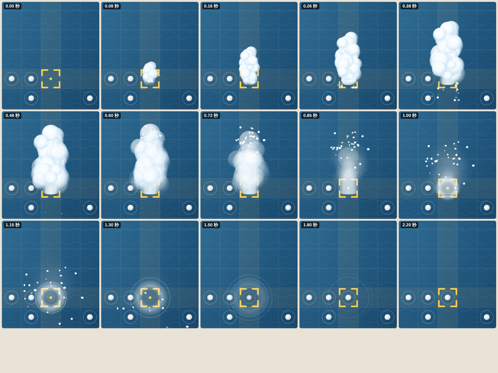

# バトルシップ — 盤面の見本(第 2 版・PC 版)

ユーザーの指摘(2026-11-28): AI が作った感じが強い(特に字)・爆発の質感・右側が文字だけで分かりにくい・側板の「撃沈 0/5」が数字でずれる・沈む演出と水柱。
並び(左に敵の海域、右に自分の艦隊、下に艦隊の一覧)と艦の絵はそのまま。撮影: `node docs/mockups/battleship-v2/shoot.cjs <woff2 のフォルダ>`(先に `python3 -m http.server -d web 8400`)。

| 攻撃中 | 配置 |
|---|---|
|  |  |

演出(2026-11-28 第 2 版で水柱と沈む所を作り直し)。撮影: `node docs/mockups/battleship-v2/shoot_fx.cjs <woff2 のフォルダ>`(時間を止めたコマと動画)。

水柱(外れ・`water.mp4`): 

- 白い水の玉をたくさん放物線で吹き上げて柱にする(真ん中ほど高く、少しずつ遅れて出るので下から伸び、根元は海面とつながったまま)。上へ行くほど遅くなり、頂上で細かいしぶきに砕け、重さで崩れて霧になる。根元に泡の輪、波紋 3 重、最後に白いピンだけが残る(約 1.5 秒)。

撃沈(`sink.mp4`): 

- 最後の 1 発の爆発から、誘爆が艦の上を走り、隠れていた船体が炎の中から現れる → 横に傾く(真上からは幅が細くなり片側が暗くなる)→ 艦尾から海に引き込まれる(白く泡立つ境目の線が艦尾から艦首へ動き、その後ろは海の色をかぶって消える。艦首は沈む前に少し持ち上がる)→ 火はその場所が沈んだ時に白い湯気になって消え、泡が噴き出し、油と破片が広がり、細長い波紋が出る → 盤の「沈んだ艦」と同じ姿が残る(約 6 秒)。

- 字: 座標・数は Barlow Condensed(計器のような細い字)、日本語は Zen Kaku Gothic New。字間を空けた太字の見出しをやめ、見出しは左寄せの小さな札(照準・錨の印つき)。
- 外れ = 白いピン+波紋。命中 = 焦げ跡+赤いピン+揺れる火と煙。沈んだ艦 = 黒ずんで少し傾き、海の色をかぶり、油が浮く(演出の最後と同じ姿)。
- 照準は、四隅のかぎ括弧と行・列の淡い帯。発射ボタンに座標を出す(「G5 へ発射」)。
- 敵の艦隊は、見つかっていない艦を点線の輪郭、沈めた艦を黒ずんだ絵+赤い斜線。自分の艦隊は、被弾したマスに赤い点。文字の「健在・損傷・撃沈」はやめた。
- 側板: 両者とも「残り 4 隻」+艦の形の印 5 つ(同じ形・同じ幅なので、数が変わっても揃って動かない)。メモ欄は「最近の砲撃」(誰が・どこへ・結果)。結果の帯(「相手の攻撃はハズレ」など)は、演出で分かるのでやめた。
- 配置: 右は「ドック」。艦を盤と同じ縮尺で並べ、置いた艦は薄く✓。操作の説明はマウスの絵+短い 2 行。
