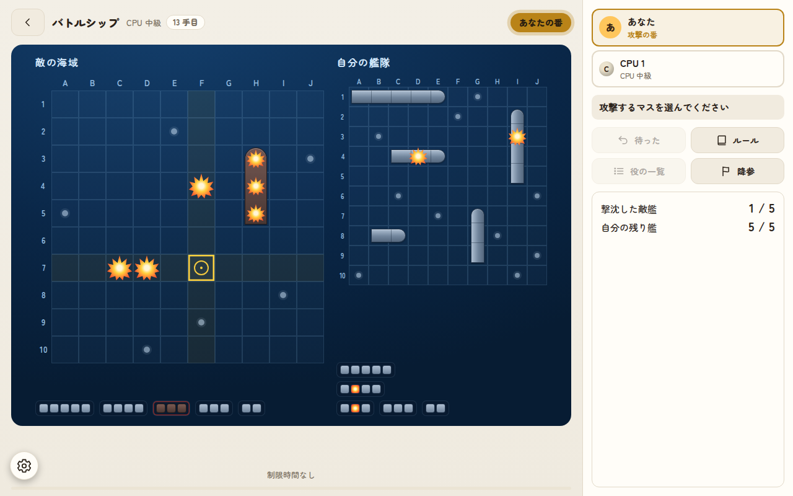
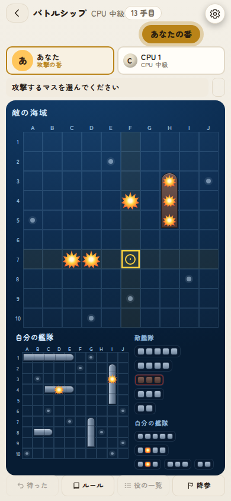

# バトルシップ — 盤面の見本(第 1 版・PC 版)

**アプリ未実装**(コアのみ実装済み: `web/pc-firebase/core/games/battleship.mjs`、引き継ぎ資料は `docs/NEW_GAMES_CORE_SPEC_FOR_AI.md`)。この見本は、了承を得るための絵。

## 盤面

- 実際の対局画面(左上の戻る・右の側板・左下の設定は全ゲーム共通)の `#boardwrap` に盤だけを差し込んでいる(リバーシの画面を借用)。撮影は `node docs/mockups/battleship/shoot.cjs`(先に `python3 -m http.server -d web 8400`、Playwright が必要)。
- 場面: 対戦の途中。両者 12 発ずつ撃った後、あなたの攻撃の番。
- 左が敵の海域(10×10、座標 A〜J・1〜10)。コアの view が返す情報だけを描く前提で、見えるのは自分の射撃結果のみ: 命中は爆発、 外れは淡い点、撃沈した 3 マスの艦だけ船体が見える。下段は敵の艦隊(長さ 5・4・3・3・2 のチップ。撃沈分は暗く赤枠)。
- 照準中のマス(F7)は、その行と列を淡く光らせ、丸い照準で示す。命中が並んだ行の延長上に置いてある。
- 右が自分の艦隊(10×10 を小さく)。5 隻とも健在で、4 マスの艦と 3 マスの艦に 1 発ずつ被弾。下段のチップに被弾位置を示す。
- 側板の中身(手番・案内・撃沈数)は、ほかのゲームと同じ欄(`#strip`・`#status`・`#sidenote`)に入れている。

## スマホ版(第 1 版)

- PC 版と同じ場面を、縦画面(390×844)でスクロールなしの 1 画面に収まるよう組み替えたもの。撮影は `node docs/mockups/battleship/shoot_mobile.cjs`(盤面コードは `battleship_mobile_board.js`、リバーシの画面を借用)。
- 配置は上下 2 段: 上段に敵の海域を幅いっぱいに大きく(10×10、1 マス 33px、座標 A〜J・1〜10 つき。タップしやすい大きさを確保)、下段左に自分の艦隊を小さく(1 マス 18px)、下段右に敵艦隊のチップ(縦積み、撃沈分は暗く赤枠)と自分の艦隊のチップ(被弾位置つき)をコンパクトに置く。盤全体の高さは約 630px で、ページ全体はスクロールしない(scrollHeight = 844 で確認)。
- 秘匿は PC 版と同じ: 敵の海域に見えるのは自分の射撃結果(命中=爆発、外れ=淡い点、撃沈した艦の船体)だけ。照準 F7 はリングと行・列の帯で示す。
- 操作はマスの直接タップのみで、下のボタン行(`#acts`)は空。スマホでは `#sidenote` が状態文の帯と重なることがあるため空にし、撃沈数などの情報は盤の中のチップで示している。
