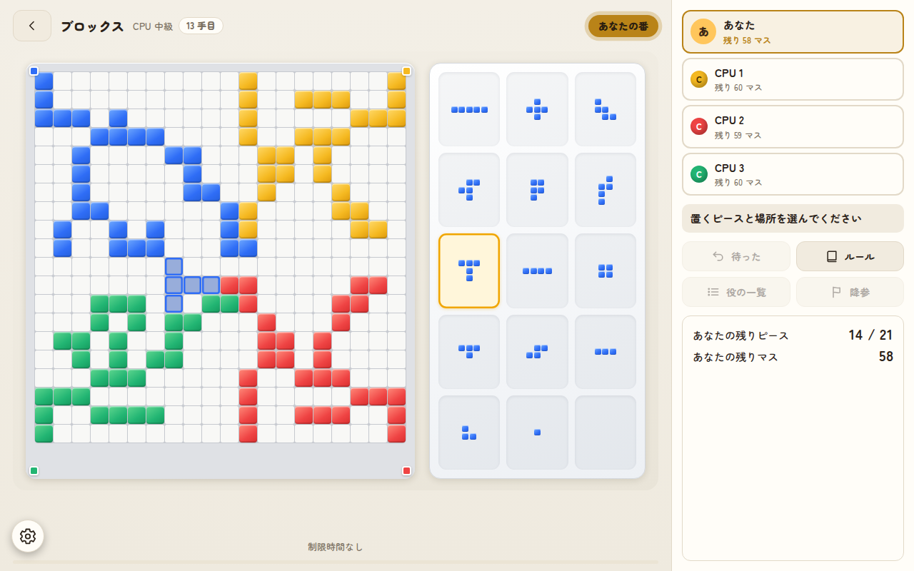
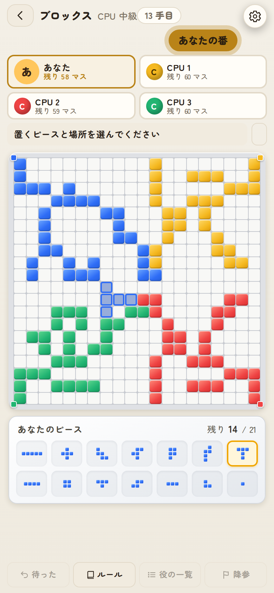

# ブロックス — 盤面の見本(第 1 版・PC 版)

**アプリ未実装**(コアのみ実装済み: `web/pc-firebase/core/games/blokus.mjs`、引き継ぎ資料は `docs/NEW_GAMES_CORE_SPEC_FOR_AI.md`)。この見本は、了承を得るための絵。

## 盤面

- 実際の対局画面(左上の戻る・右の側板・左下の設定は全ゲーム共通)の `#boardwrap` に盤だけを差し込んでいる(たこ焼きの画面を借用)。撮影は `node docs/mockups/blokus/shoot.cjs`(先に `python3 -m http.server -d web 8400`、Playwright が必要)。
- 場面: 4 人戦(20×20)の中盤。各色 7 ピースずつ置いた後、青(あなた)の番。
- 色と角はコアの仕様どおり: 青=左上、黄=右上、赤=右下、緑=左下。配置はすべて規則どおりで、同色どうしは角でのみ接し、辺では接しない(検証済み)。初手は各色とも自分の角を含んでいる。
- 盤の右は、あなたの残りピースのトレイ(残り 14 種)。使った 7 種(V・Y・L・Z・U・4 マス L・2 マス)は抜けている。金色の枠が付いた T 字型が選択中で、盤の中央付近に同じ形のゴーストが、青の領地と角で接する合法位置に出ている。
- 側板の中身(残りマス数・残りピース数)は、ほかのゲームと同じ欄(`#strip`・`#status`・`#sidenote`)に入れている。残りマス数は、置いたマス数(青 31・黄 29・赤 30・緑 29)から計算した値。

## スマホ版

- 撮影は `node docs/mockups/blokus/shoot_mobile.cjs`(ビューポート 390×844、たこ焼きの画面を借用)。盤面コードは `blokus_mobile_board.js`。場面と配置データは PC 版と同一。
- **1 画面にスクロールなしで収める**ことを絶対条件にした(scrollHeight = 844 で確認済み)。盤は幅いっぱい(最大 374px、1 マス約 17px)で、PC 版で盤の右にあったトレイは、盤の下に横長の帯として置いた。残りピース 14 種を 1 マス約 5px の小さな形アイコンで 2 段(7 列 × 2 段)に並べ、選択中の T 字型には金の枠を付けている。盤+トレイで縦は約 500px に収まる。
- 残りピース数(14 / 21)はトレイの見出しに置いた。スマホでは `#sidenote` が状態の文の帯と重なるため使わず、大事な情報は `#strip`(残りマス数)・`#status`・盤の中に寄せている。プレイヤー表示はスマホ画面の 2×2 カードにそのまま収まる。
- 設計意図(ズーム): 20×20 はスマホでは 1 マス約 17px と小さく、誤タップしやすい。まず拡大なしで全体を見渡して置けることを優先し、そのうえで実装時は**盤だけ**のピンチズームを補助として許可する想定。ズームやスクロールの範囲に入れるのは盤のみで、トレイ・プレイヤー表示・最下部の操作ボタン行はズーム範囲に入れない(拡大した盤の上でも、置く操作はトレイで選んだピースのゴースト確認→タップ確定の流れを崩さない)。
