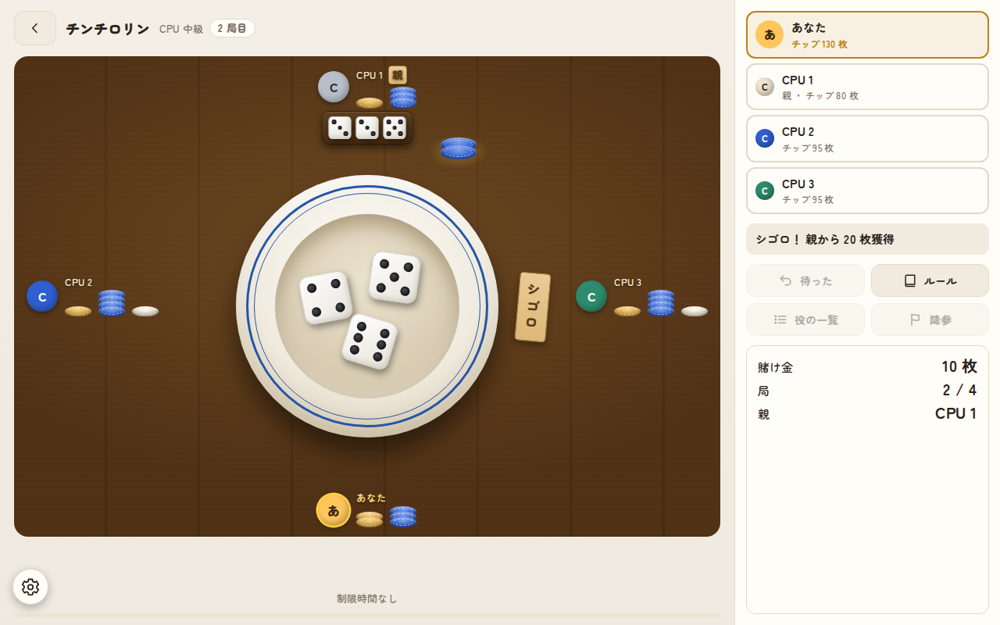
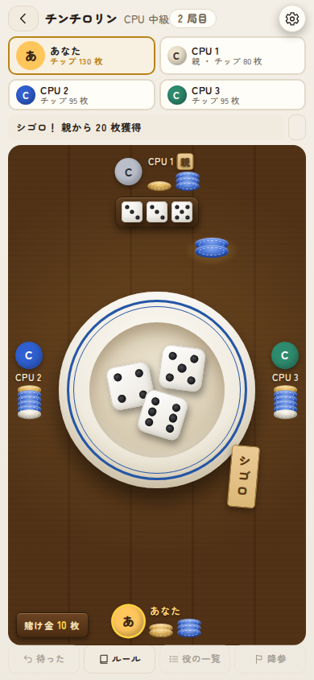

# チンチロリン — 盤面の見本(第 1 版・PC 版)

**アプリ未実装**(コアのみ実装済み: `web/pc-firebase/core/games/chinchiro.mjs`、引き継ぎ資料は `docs/NEW_GAMES_CORE_SPEC_FOR_AI.md` の「9. チンチロリン」)。この見本は、了承を得るための絵。

## 盤面

- 実際の対局画面(左上の戻る・右の側板・左下の設定は全ゲーム共通)の `#boardwrap` に盤だけを差し込んでいる(たこ焼きの画面を借用)。撮影は `node docs/mockups/chinchiro/shoot.cjs`(先に `python3 -m http.server -d web 8400`、Playwright が必要)。
- 場面: 2 局目・賭け金 10 枚。親の CPU 1 は「3・3・5 = 目 5」で確定済み。子であるあなたが「4・5・6 = シゴロ」で親に勝ち、20 枚(2 倍)を受け取るところ。CPU 2・CPU 3 はこれから振る。
- 卓は居酒屋のような濃い木のテーブル。中央の丼(白磁に青い二重線)の中に、あなたのダイス(4・5・6)が少し傾いて転がっている。丼の脇に木札「シゴロ」、丼と親の間に精算のチップ(青 10 枚チップ 2 枚 = 20 枚)。
- 親(CPU 1)の席には「親」の木札マーカーと、結果のダイス(3・3・5)を置く小盆。各席のチップは 金 = 50 / 青 = 10 / 白 = 5 の積み重ねで表し、合計が保存される(あなた 130 / 親 80 / CPU 2 95 / CPU 3 95 = 400)。
- 側板の中身(チップ数・案内・賭け金と局)は、ほかのゲームと同じ欄(`#strip`・`#status`・`#sidenote`)に入れている。振る操作は丼を押す想定で、この場面では `#acts` は空。

## スマホ版(第 1 版)

- 撮影は `node docs/mockups/chinchiro/shoot_mobile.cjs`(ビューポート 390×844、盤は `chinchiro_mobile_board.js`)。場面は PC 版と同じ(2 局目、あなたがシゴロで親から 20 枚を受け取るところ)。
- スクロールなしで 1 画面に収めた(scrollHeight = 844)。丼は直径約 244px で画面中央の主役にし、ダイス(54px)も指で読みやすい大きさを保った。
- 左右の席(CPU 2・CPU 3)は丼の脇の細い余白に収めるため縦積みにし、チップは色ごとの山ではなく 金・青・白 を混ぜた 1 本の山で表した(合計は側板の表示と一致)。
- スマホでは `#sidenote` が状態文の帯と重なりやすいため空にし、賭け金 10 枚は盤の左下に木のプレートで置いた。チップ数と精算の文は `#strip` と `#status` に寄せている。
- 実装時の注意: アプリ側に `.side` / `.col` / `.nm` などの汎用クラスがあるため、盤側のクラス名は接頭辞付きの固有名にすること(この見本では `ccm-` に統一)。
