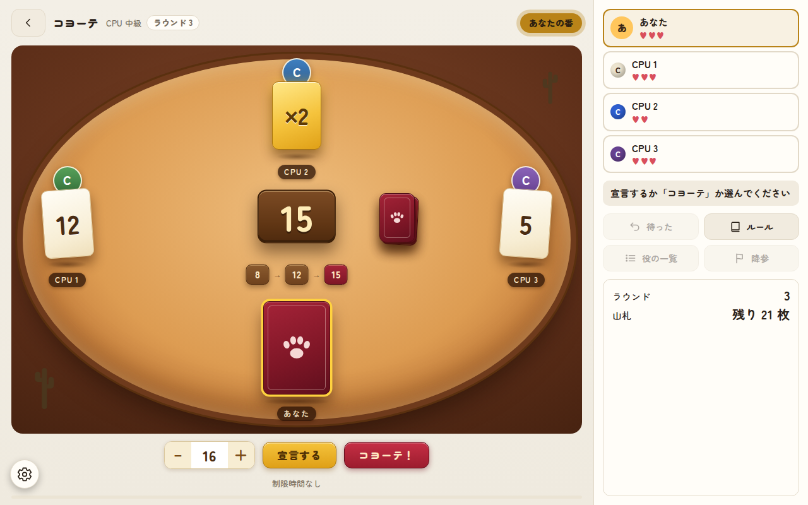
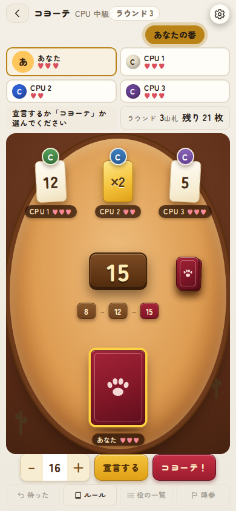

# コヨーテ — 盤面の見本(第 1 版・PC 版)

**アプリ未実装**(コアのみ実装済み: `web/pc-firebase/core/games/coyote.mjs`、仕様は `docs/COYOTE_SPEC_FOR_AI.md`、引き継ぎ資料は `docs/NEW_GAMES_CORE_SPEC_FOR_AI.md`)。この見本は、了承を得るための絵。

## 盤面

- 実際の対局画面(左上の戻る・右の側板・左下の設定は全ゲーム共通)の `#boardwrap` に盤だけを差し込んでいる(たこ焼きの画面を借用)。撮影は `node docs/mockups/coyote/shoot.cjs`(先に `python3 -m http.server -d web 8400`、Playwright が必要)。
- 場面: 4 人・特殊カードあり・ライフ 3。ラウンド 3 で、宣言が 8 → 12 → 15 と進み、あなたの番。
- 夕暮れの砂漠色の楕円の卓に対戦相手 3 人(上 = CPU 2、左 = CPU 1、右 = CPU 3)を置き、額の札のように立つカードで全員の数字が見える。CPU 2 の「×2」は特殊カードとして金色の札。あなたのカードだけ裏向き(深紅に白い足跡の模様)で、下側に大きめに置き、手番の金の輪で示す。
- 中央は現在の宣言「15」の木札プレートと、その下に宣言の履歴チップ(8・12・15)。右に裏向きの山札の束。
- 操作は盤の下(`#acts`): 次の宣言のステッパー(16、− ＋)＋「宣言する」＋赤い「コヨーテ！」。
- 側板の中身(ライフのハート・案内・ラウンドと山札の残り)は、ほかのゲームと同じ欄(`#strip`・`#status`・`#sidenote`)に入れている。

## スマホ版(第 1 版)

- 撮影は `node docs/mockups/coyote/shoot_mobile.cjs`(ビューポート 390×844、たこ焼きの画面を借用)。盤の差し込みコードは `coyote_mobile_board.js`。
- PC 版と同じ場面(ラウンド 3、宣言 8 → 12 → 15、あなたの番)を、縦画面に合わせて再配置したもの。ページ全体はスクロールせず 1 画面に収まる(scrollHeight = 844 で確認)。
- 工夫: 横長の楕円卓を縦に圧縮し、相手 3 人は上部に横一列(左 = CPU 1「12」、中央 = CPU 2 の金色「×2」、右 = CPU 3「5」)。各席はアバター+カード+名前とライフの小表示でまとめ、カードは幅 50px でも数字が読める大きさにした。中央に宣言プレート「15」と履歴チップ、その右に山札。下部中央にあなたの伏せカード(少し大きめ・金の枠)。
- 操作(`#acts`)は 1 行に収めた: 宣言ステッパー(16、− ＋)+「宣言する」+「コヨーテ！」。ボタンとステッパーの高さは 44px で、タップしやすさを保っている。
- ライフなどの大事な情報は、スマホでは見えにくい `#sidenote` に頼らず、`#strip` と盤の中(各席の名前札)にも置いた。
