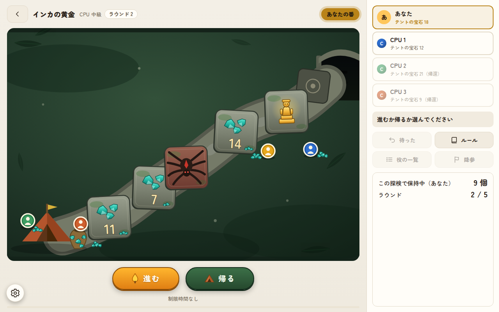
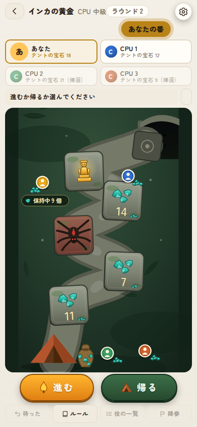

# インカの黄金 — 盤面の見本(第 1 版・PC 版)

**アプリ未実装**(コアのみ実装済み: `web/pc-firebase/core/games/incangold.mjs`、引き継ぎ資料は `docs/NEW_GAMES_CORE_SPEC_FOR_AI.md`、詳細仕様は `docs/INCANGOLD_SPEC_FOR_AI.md`)。この見本は、了承を得るための絵。

## 盤面

- 実際の対局画面(左上の戻る・右の側板・左下の設定は全ゲーム共通)の `#boardwrap` に盤だけを差し込んでいる(たこ焼きの画面を借用)。撮影は `node docs/mockups/incangold/shoot.cjs`(先に `python3 -m http.server -d web 8400`、Playwright が必要)。
- 場面: ラウンド 2 の探検中。カードは 宝石11 → 宝石7 → 障害(クモ) → 宝石14 → 遺物 の 5 枚がめくれ、残っている探検者は あなた と CPU 1 の 2 人だけ(CPU 2・CPU 3 は帰還済み)。「進むか帰るか」を選ぶ場面。
- 神殿の石畳の道が入口(左下のキャンプ)から奥(右上の神殿の入口)へ緩やかに蛇行し、めくられたカードが石のタイルとして道沿いに並ぶ。宝石タイルには宝石の絵と数字、隅に余りのターコイズの小石。障害タイルは赤みのある石にクモ、遺物タイルは金の像。
- 探検者は色付きの丸コマ: あなた(金)と CPU 1(青)が最新のタイル(遺物)の脇に、帰還した CPU 2(緑)と CPU 3(橙)がキャンプ(テントと宝石袋)の脇にいる。コマの脇の小石の山が保持分の宝石。
- 道の先には裏向きの次のタイルと、闇に沈む神殿の入口。
- `#acts` に「進む」(松明)／「帰る」(テント)の 2 ボタンを大きく置く。同時選択の操作はここだけ。
- 側板の中身(テントの宝石数・案内・保持中の宝石とラウンド)は、ほかのゲームと同じ欄(`#strip`・`#status`・`#sidenote`)に入れている。帰還した 2 人の行は薄く表示。

## スマホ版(第 1 版)

- 撮影は `node docs/mockups/incangold/shoot_mobile.cjs`(ビューポート 390×844、たこ焼きの画面を借用)。盤の差し込みは `incangold_mobile_board.js`。場面は PC 版と同じ(ラウンド 2、カード 5 枚がめくれた後の「進むか帰るか」)。
- 縦画面を活かし、石畳の道を縦に蛇行させた: 下部に入口とキャンプ(テント・宝石袋・帰還した 2 人のコマ)、道沿いにタイル 5 枚(宝石 11 → 宝石 7 → クモ → 宝石 14 → 遺物)、上部に神殿の入口と裏向きの次のタイル。タイルは PC 版より一回り小さく(96 角)し、スクロールなしで 1 画面に収めた(scrollHeight = 844 を撮影時に確認)。
- 探検者コマ(あなた=金、CPU 1=青)は最新の遺物タイルの脇に配置。
- スマホでは `#sidenote` の欄が案内文の帯と重なって表示されるため、スマホ版では空にし、保持中の宝石(9 個)は盤の中の札に、ラウンドは `#hround` の札に出している(テントの宝石数は `#strip`)。
- `#acts` は「進む」／「帰る」の大きな 2 ボタンを横並び(PC 版と同じ絵柄)。
