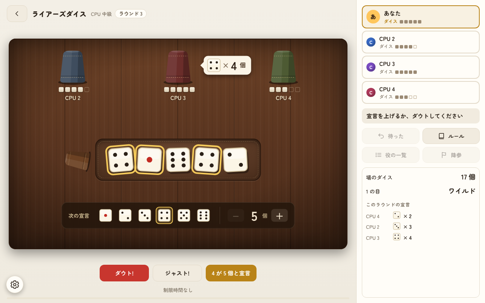
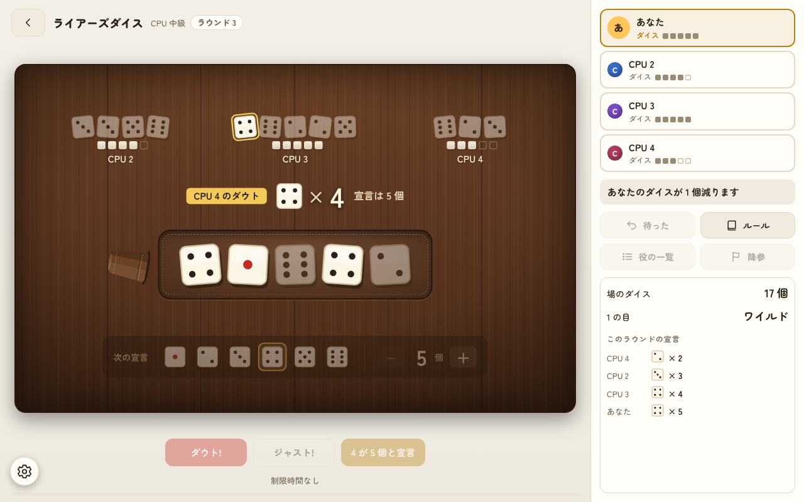

# ライアーズダイス — 盤面の見本(第 2 版・PC 版)

ユーザーの指摘(2026-11-28): 配置がわざとらしい・分かりにくい・字が AI っぽい。撮影: `node docs/mockups/liarsdice-v2/shoot.cjs <woff2 のフォルダ>`。

| あなたの番 | ダウトでカップを開けた所 |
|---|---|
|  |  |

- 上から「相手 → 自分のダイス → 次の宣言」の順に並べ、目の動きを上から下へ 1 本にした(楕円の卓・中央の宣言の札・カップの横のチップをやめた)。
- 卓は木のテーブル。相手は革のカップを伏せ、その下に残りのダイスの数を小さな四角で(なくしたダイスは空の四角)。チップの数字はやめた。
- 今の宣言は、言った人のカップの横に吹き出しで出す。これまでの宣言は側板の「このラウンドの宣言」に並べる。
- 自分のダイスは革の受け皿に大きく。今の宣言の目(4)とワイルドの 1 を金の枠で示す。
- 次の宣言は、目と個数を 1 本の欄にまとめた(「次の宣言 [1〜6] | − 5 個 +」)。ボタンは「ダウト!」「ジャスト!」「4 が 5 個と宣言」の 3 つ。
- 公開の時: 全員のダイスを出し、当てはまる目以外を暗くする。中央に「CPU 4 のダウト」「4 × 4」「宣言は 5 個」。宣言の欄は消さずにグレーアウト。
- 字は日本語を Zen Kaku Gothic New に。側板のダイス数も四角の印で、全員同じ幅。
