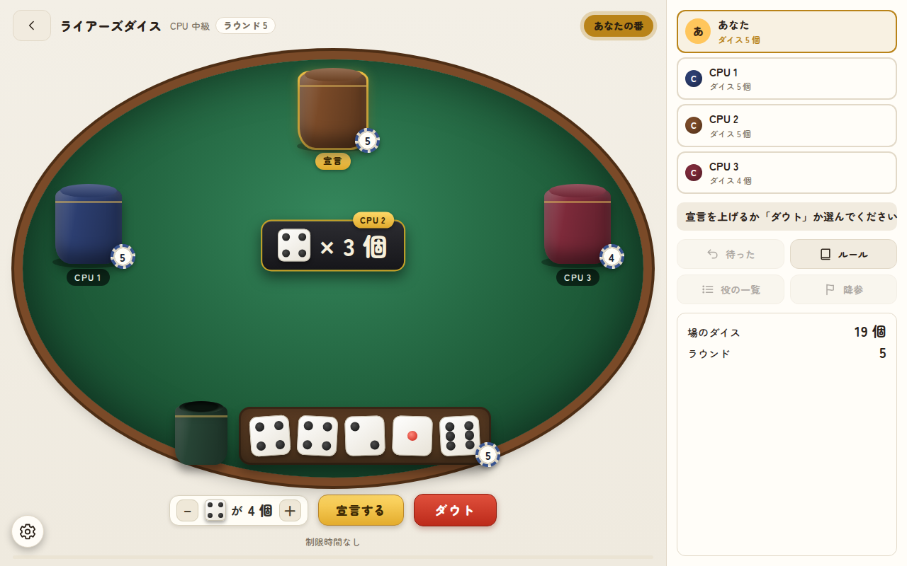
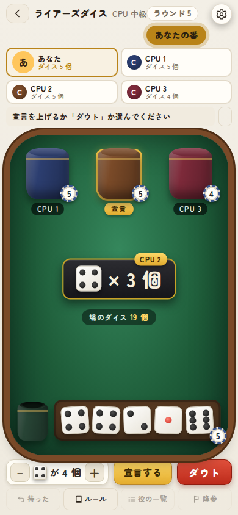

# ライアーズダイス — 盤面の見本(第 1 版・PC 版)

**アプリ未実装**(コアのみ実装済み: `web/pc-firebase/core/games/liarsdice.mjs`、引き継ぎ資料は `docs/NEW_GAMES_CORE_SPEC_FOR_AI.md` と `docs/LIARSDICE_SPEC_FOR_AI.md`)。この見本は、了承を得るための絵。

## 盤面

- 実際の対局画面(左上の戻る・右の側板・左下の設定は全ゲーム共通)の `#boardwrap` に盤だけを差し込んでいる(たこ焼きの画面を借用)。撮影は `node docs/mockups/liarsdice/shoot.cjs`(先に `python3 -m http.server -d web 8400`、Playwright が必要)。
- 場面: 4 人対戦・ラウンド 5・1 のワイルドあり。CPU 2 の宣言が「4 が 3 個」で、今があなたの番。
- 卓は楕円のカジノ卓(深緑フェルト＋木の縁)。相手 3 人は色付きのカップ(紺・革の茶・臙脂)を伏せて置き、中身は見えない。カップの脇のチップが残りダイス数(CPU 3 だけ 4 個)。
- 宣言中の CPU 2 は、カップの金のリングと「宣言」の札で示す。中央の宣言プレートに、目「4」のミニダイスと「× 3 個」、宣言者の札を置く。
- あなたはカップを開けた状態で、自分の 5 個 [4・4・2・1・6] が下のトレイに見える(1 の目だけ赤)。開けたカップはトレイの左に立てる。
- 盤の下の操作欄に、次の宣言のステッパー(目 4 のまま「4 が 4 個」へ上げる表示)と「宣言する」「ダウト」のボタンを置く。
- 側板の中身(手番・ダイスの残数・場のダイス 19 個)は、ほかのゲームと同じ欄(`#strip`・`#status`・`#sidenote`)に入れている。

## スマホ版(第 1 版)

- 撮影は `node docs/mockups/liarsdice/shoot_mobile.cjs`(ビューポート 390×844、たこ焼きの画面を借用)。盤面コードは `liarsdice_mobile_board.js`。場面は PC 版と同じ。
- 楕円卓を縦長の卓に圧縮し、相手 3 人のカップは上部に横一列(紺・革の茶・臙脂、残りダイス数のチップつき)。宣言中の CPU 2 は金のリングと「宣言」の札で示す。
- 中央に宣言プレート(目「4」のミニダイス＋「× 3 個」＋宣言者 CPU 2 の札)。その下に「場のダイス 19 個」の札を置いた(スマホでは `#sidenote` が見えにくいため、卓の上に置き、`#sidenote` は空にして重複を避けた)。
- 下部に開けたカップとトレイを置き、自分の 5 個 [4・4・2・1・6] を大きく見せる(1 の目だけ赤)。
- 操作欄は 1 行に収めた: 次の宣言のステッパー(「4 が 4 個」)＋「宣言する」＋「ダウト」。ページ全体はスクロールなし(scrollHeight = 844)で、下部の操作ボタン行まで 1 画面に収まる。
