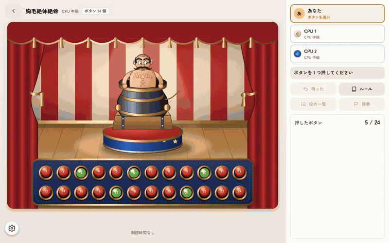
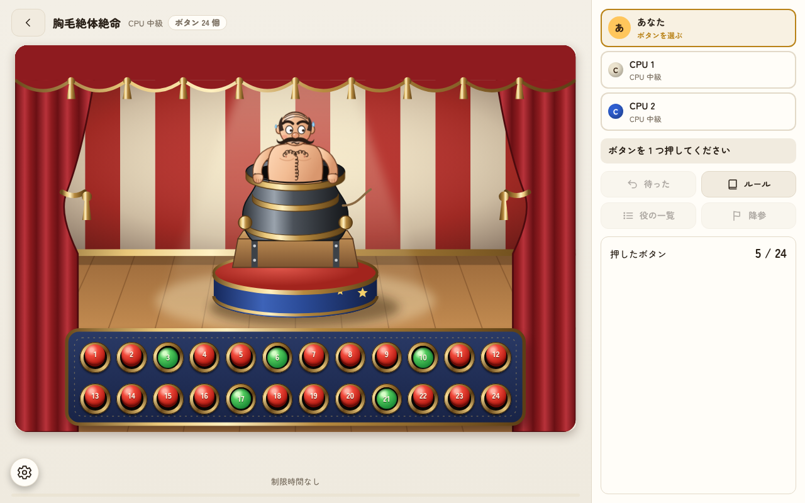
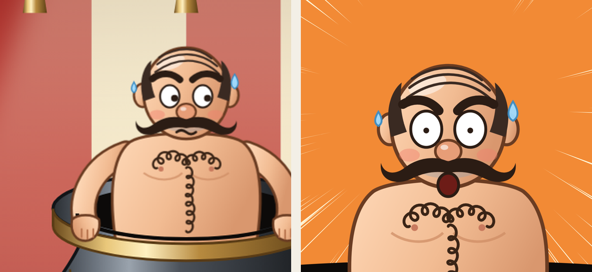
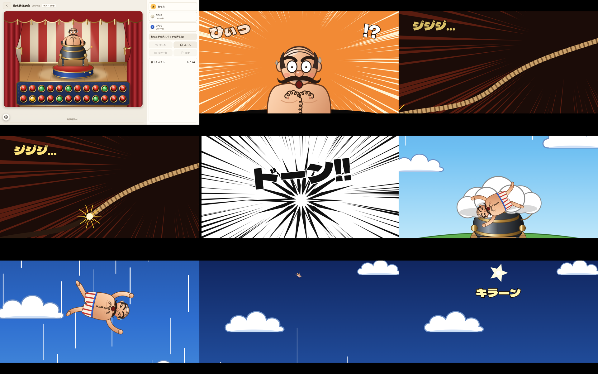

# 胸毛絶体絶命 — 盤面の見本(第 3 版・PC 版、胸毛は第 5 版)

黒ひげ危機一髪がモチーフ。アプリ本体にはまだ入れていない(了承後に実装)。

## 打ち上げのアニメ(動画)


MP4: [launch.mp4](launch.mp4)

## 盤面


- 実際の対局画面(左上の戻る・右の側板・左下の設定は全ゲーム共通)の `#boardwrap` に盤だけを差し込んでいる。
- 盤: サーカスの舞台。星の太鼓の台に載せた臼砲の中に、胸毛のおっさん。下の操作盤にボタン 24 個(12 個 × 2 段)。押す前は赤、押すと緑。
- 外れ(点火スイッチ)を押すと、黒帯つきのアニメ映像に切り替わる: 驚く顔の大写し → 導火線を火が走る → ドーン(白黒の一瞬の絵)→ 打ち上げ(カメラが追って空へ)→ キラーン → アプリと同じ赤のカットイン「ゲームオーバー / 〇〇の負け」。

## 胸毛(ペンでくるくる描いた線)


胸の上を左右へ 1 本、真ん中を へそ へ 1 本、ループの連なった線で描く(`coil`)。輪の大きさを少しずつ揺らして手描きらしくしている。比べる絵は `node docs/mockups/munage/compare_hair.cjs` で作る(左: 盤の上、右: アニメの大写し)。

## コマ送り


## 作り直し方
```bash
python3 -m http.server -d web 8400
node docs/mockups/munage/shoot.cjs
```
`munage_board.js` を、たこやきの対局画面に差し込んで撮る(board.png・frames.png・launch.mp4・launch.gif)。
