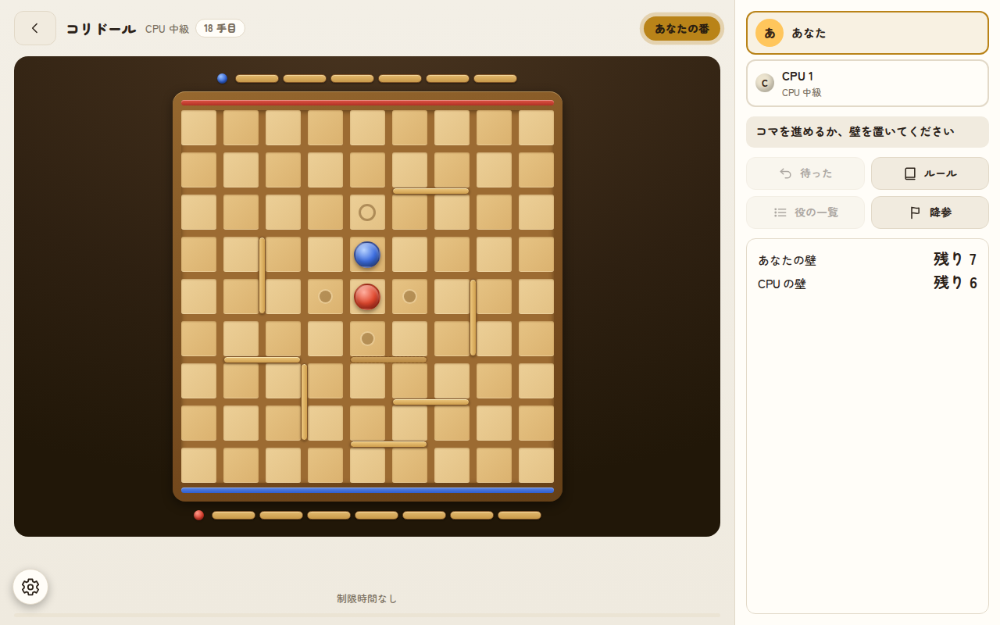
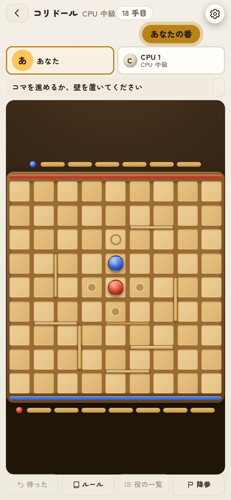

# コリドール — 盤面の見本(第 1 版・PC 版)

**アプリ未実装**(コアのみ実装済み: `web/pc-firebase/core/games/quoridor.mjs`、引き継ぎ資料は `docs/NEW_GAMES_CORE_SPEC_FOR_AI.md`)。この見本は、了承を得るための絵。

## 盤面

- 実際の対局画面(左上の戻る・右の側板・左下の設定は全ゲーム共通)の `#boardwrap` に盤だけを差し込んでいる(リバーシの画面を借用)。撮影は `node docs/mockups/quoridor/shoot.cjs`(先に `python3 -m http.server -d web 8400`、Playwright が必要)。
- 場面: 中盤、あなたの番。あなた(赤)は下から上へ、CPU(青)は上から下へ進む。
- 盤: 9×9 の木の盤。マスの間に壁を差す溝を掘り、最上段の辺に赤(あなたのゴール)、最下段の辺に青(CPU のゴール)の細い帯。
- コマ: 中央で赤(4,4)と青(4,3)が向き合っている。赤の移動候補は、左・右・下の淡い丸と、青を飛び越えた先(4,2)の輪で示す。
- 壁: 置いてある 7 枚(横 4・縦 3、コアの `hWalls` / `vWalls` と同じ位置の表し方)に、CPU が飛び越えた先の進路を塞ごうとしている 1 枚(列 4・5、行 5 と 6 の境界)を半透明のゴーストで示す。
- 壁の残数: 盤の上の置き場に CPU の 6 本、下の置き場にあなたの 7 本を、棒そのものの本数で示す(先頭の丸は持ち主の色)。
- 側板の中身(手番・案内・壁の残数)は、ほかのゲームと同じ欄(`#strip`・`#status`・`#sidenote`)に入れている。

## スマホ版(第 1 版)

- 撮影は `node docs/mockups/quoridor/shoot_mobile.cjs`(ビューポート 390×844、リバーシの画面を借用)。盤の差し込みは `quoridor_mobile_board.js`。場面・壁・コマの配置は PC 版と同一。
- **スクロールなしで 1 画面に収める**(撮影時に scrollHeight = 844 = 画面の高さであることを確認)。最下部の操作ボタン行まで全て見える。
- 盤は横幅いっぱい(盤本体 358px、枠込みで画面幅 390px にほぼ収まる)に広げ、マスは約 34px でタップしやすくした。盤まわり全体の縦は約 450px。
- 壁の置き場は PC 版と同じく盤の上下に置くが、細い帯として盤と一体化し、余白を削った。残数は棒の本数そのもので示すため、スマホでは重なりやすい `#sidenote` には頼らない(空にしている)。
- 操作は盤の直接タップのみで完結するため、ボタン行(`#acts`)は空。拡大縮小・スクロールは不要な設計。
