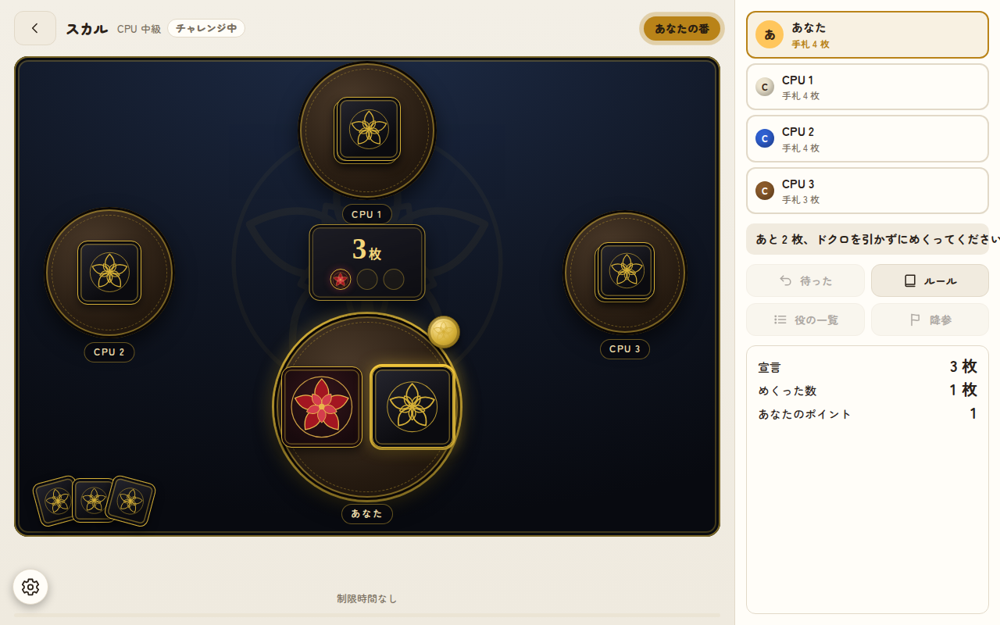
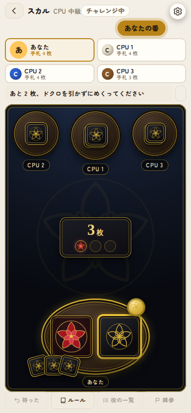

# スカル — 盤面の見本(第 1 版・PC 版)

**アプリ未実装**(コアのみ実装済み: `web/pc-firebase/core/games/skull.mjs`、引き継ぎ資料は `docs/NEW_GAMES_CORE_SPEC_FOR_AI.md`、詳細仕様は `docs/SKULL_SPEC_FOR_AI.md`)。この見本は、了承を得るための絵。

## 盤面

- 実際の対局画面(左上の戻る・右の側板・左下の設定は全ゲーム共通)の `#boardwrap` に盤だけを差し込んでいる(たこ焼きの画面を借用)。撮影は `node docs/mockups/skull/shoot.cjs`(先に `python3 -m http.server -d web 8400`、Playwright が必要)。
- 場面: 4 人対戦、チャレンジのめくり中。あなたが「3 枚」と宣言した宣言者で、獲得済み 1 ポイント。自分の場の 2 枚のうち 1 枚(花)はめくり済み、あと 2 枚めくれば成功の場面。
- 世界観は Skull & Roses のバイカー調。黒〜濃紺の卓に金の縁取り、各プレイヤーの前に丸いレザー調コースター(マット)を置き、その上に伏せたカードの山を置く。カード裏面は黒地に金のバラの紋章、花カードは深紅と金のバラ。
- 配置: あなたは下(場のカードを大きめに表示。めくり済みの花 1 枚+次にめくる伏せ 1 枚を金の枠で強調。獲得済みポイントは金のバラトークン 1 個)、CPU 1 は上(伏せ 2 枚)、CPU 2 は左(伏せ 1 枚)、CPU 3 は右(伏せ 2 枚、手札を 1 枚失っているぶん山を小さめに)。あなたの手札 3 枚は左下に小さく扇形に添えた。
- 中央: 宣言「3 枚」のプレートと、めくった数の進み(花 1 つ点灯・残り 2 枠)。
- コアの view が返す情報だけを描く前提で、他人の伏せカードの中身は描いていない。
- 側板の中身(手番・案内・宣言とめくった数)は、ほかのゲームと同じ欄(`#strip`・`#status`・`#sidenote`)に入れている。

## スマホ版(第 1 版)

- 撮影は `node docs/mockups/skull/shoot_mobile.cjs`(ビューポート 390×844、盤面コードは `skull_mobile_board.js`)。場面は PC 版と同じ(チャレンジのめくり中、宣言「3 枚」、花 1 枚めくり済み)。
- レイアウトは縦の 3 段構成に再編した。上段: 相手 3 人のマットを小さく横一列(左から CPU 2・CPU 1・CPU 3。PC 版の左・上・右の位置関係に対応)。中段: 宣言プレート「3 枚」+めくりの進み(花 1 つ点灯・残り 2 枠)。下段: 自分の場を大きく(花の表 1 枚+次にめくる伏せ 1 枚を金の枠で強調)、金のバラのポイントトークン、手札 3 枚の扇はマットの左下に小さく重ねた。
- スクロールなしで 1 画面に収めている(scrollHeight = 844 を実測)。操作は盤の直接タップのみで、`#acts` は空。自分のカードは 86px、相手の伏せ札も 41〜46px と、タップしやすい大きさを保った。
- スマホでは `#sidenote` が状態文の流れに割り込んで読みにくくなるため空にし、宣言数・めくった数・ポイントは盤の中(宣言プレート・進み表示・トークン)で見せる。手札数は `#strip` に 4 人分入れた。
