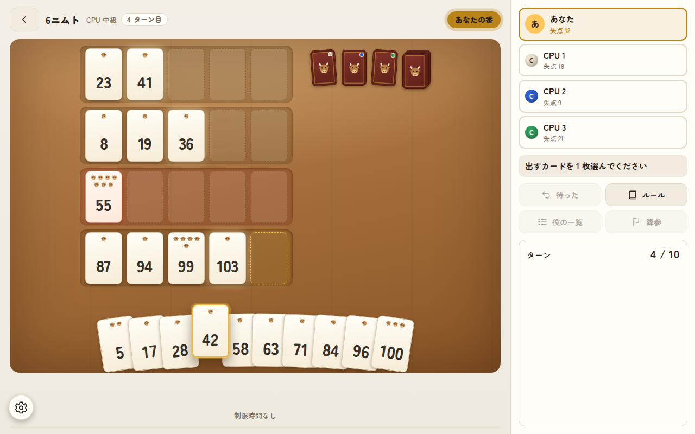
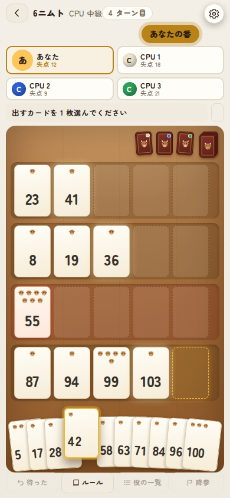

# 6ニムト — 盤面の見本(第 1 版・PC 版)

**アプリ未実装**(コアのみ実装済み: `web/pc-firebase/core/games/take6.mjs`、引き継ぎ資料は `docs/NEW_GAMES_CORE_SPEC_FOR_AI.md`)。この見本は、了承を得るための絵。

## 盤面

- 実際の対局画面(左上の戻る・右の側板・左下の設定は全ゲーム共通)の `#boardwrap` に盤だけを差し込んでいる(たこ焼きの画面を借用)。撮影は `node docs/mockups/take6/shoot.cjs`(先に `python3 -m http.server -d web 8400`、Playwright が必要)。
- 場面: 4 人対戦の 4 ターン目、全員が同時に出すカードを選ぶところ。あなたは「42」を選んで少し持ち上げている。
- 場の 4 列は卓の左〜中央に横長のレーンで置く。各列の末尾のカードには淡い光を付け、空き位置はカードと同じ大きさの破線の枠で示す。55(牛 7 頭)の列は僅かに赤くし、4 枚並んだ列 4 の次の枠は金色にしてある。
- カードは白〜クリーム地に大きな数字、上部に牛の顔を失点分だけ並べる。頭数はコアの `bullHeads` と同じ規則(55→7、11 の倍数→5、10 の倍数→3、5 で終わる→2、他→1)。
- 右上は相手 3 人が伏せて出したカード(隅の色の点は側板のアバターと対応)と山札の束。
- 側板の中身(各人の失点・案内・ターン数)は、ほかのゲームと同じ欄(`#strip`・`#status`・`#sidenote`)に入れている。失点は `#strip` 側だけに出し、`#sidenote` とは重ねていない。

## スマホ版(第 1 版)

- 撮影は `node docs/mockups/take6/shoot_mobile.cjs`(ビューポート 390×844、盤面コードは `take6_mobile_board.js`)。PC 版と同じ場面を、スクロールなしの 1 画面に収めている(撮影時に scrollHeight = 844 を確認)。
- 場のカードは幅 62px × 高さ 88px とし、5 枚+空き枠で 1 列が約 342px に収まる。4 列を縦に積み、PC 版の見せ方(末尾の光・55 の列の赤み・次の枠の金色)はそのまま。
- 手札 10 枚はピッチ 29px の扇形で収める。重なっても読めるよう、手札のカードだけ数字と牛を左寄せにし(トランプのインデックスと同じ考え方)、選択中の「42」は持ち上げて金の枠。持ち上がったカードに右隣の「58」の数字が隠れないよう、その 1 枚だけ間隔を広げてある。
- 相手の伏せカードと山札は、右上に小さく添えるだけにした。
- スマホでは `#sidenote` が状態の帯と重なって見えることがあるため空にし、情報はプレイヤー表示(失点)と `#status` と盤の中に集約した。`#acts` は空(カードを直接押す操作のため)。
